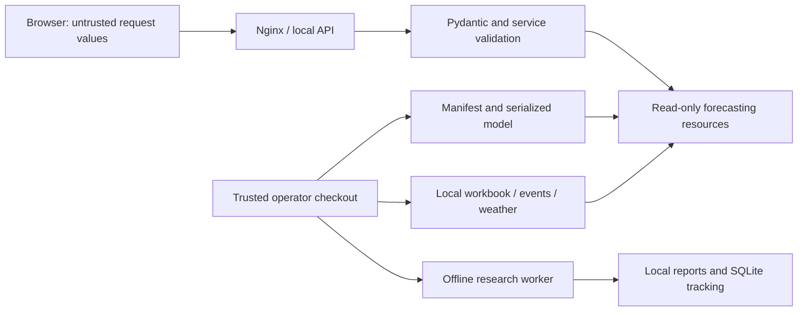

# Threat model

Reviewed scope: the FastAPI/React checkout, Docker Compose, the bundled synthetic
workbook and model, local evaluation/training, and the bounded research CLI.
This is an operator-controlled local service. Compose binds published ports to
`127.0.0.1`. It has no accounts, tenant isolation, public upload endpoint, or
built-in rate limiter. The optional Streamlit UI is a separate legacy environment;
it reuses backend feature/metric functions and is excluded from the API image.

## Assets and trust boundaries

Protect the integrity of code, model/manifest, evaluation evidence and input
files, the availability of the local service, and any operator-supplied data.
Treat browser requests and dependency updates as untrusted. Files configured by
the operator and the checked-out repository are trusted administrative inputs;
their origin is not authenticated by this application.

## Threats, controls and verification

| Threat / boundary | Implemented control | Executable evidence / remaining limit |
| --- | --- | --- |
| Modified serialized model executes code | Compare SHA-256 against the trusted manifest before deserializing the verified bytes; check runtime/schema/feature order | `test_runtime.py` prevents deserialization on checksum/runtime mismatch. An attacker who controls both model and manifest remains trusted: checksums are not signatures or a sandbox. |
| Malformed HTTP values or expensive forecast requests | Typed finite inputs, integer horizon 1–168, weather-length/range checks and explicit next-hour start | API/metric contract tests reject invalid, non-finite and overflow values. No per-client request or concurrency quota. |
| Path traversal / server-side fetching through a request | HTTP requests accept forecast values, not filenames, model paths or remote data URLs | Paths come from local operator configuration. OS file permissions protect them; do not grant configuration access to callers. |
| Wrong model/data produces misleading results | Fatal resource/schema failures refuse initialization; diagnostic identity covers model, data, code, timezone and events; data-quality flags expose gaps/incomplete model inputs | Runtime identity/cache tests, controlled HTTP 503 for fatal failures, synthetic/unverified provenance in API schemas. Operational readiness does not certify complete data or real-world accuracy; inspect `data_quality` as well as HTTP status. |
| Evaluation leakage or silent model promotion | Chronological folds, causal features, frozen research protocol, fixed seeds and bounded worker; research does not serialize or promote estimators | Experiment/training tests, repeat reports and active-model hashes. Historically reused 2024 data is explicitly not an independent holdout. |
| Research leaks input data to a hosted tracker | Explicit local SQLite MLflow URI, telemetry/OTLP off, locally written reports | Experiment tests verify tracking isolation. Operators control local report access/retention; report files may contain input-derived metrics. |
| Secrets or personal data appear in operational telemetry | Request logs omit queries and bodies; optional error reporting uses an allowlist of operational fields | Logging/error-reporting tests. Operators must restrict log access and retention; custom exception messages in local stderr can contain application details. |
| Supply-chain update introduces a vulnerability | Hash-checked Python locks, npm lock, dependency audits, weekly Dependabot and CodeQL for Python/JavaScript/Actions | Quality and Security analysis workflows. Hashes ensure selected package integrity, not publisher trust or absence of undisclosed vulnerabilities. |
| Cross-origin browser access | Explicit CORS origin list for local development; same-origin proxy in Compose | CORS is a browser policy, not authentication. Processes able to reach the API can call it directly. |

## Deployment responsibilities

Keep the default loopback binding for local use. Before exposing the service to
other users, put authentication, TLS, request/body/concurrency limits and access
logging at a reverse proxy; restrict network access and run the service with
read-only inputs and the minimum OS permissions it needs. Serve one reviewed
model/manifest pair, keep backups, and replace compromised artifacts from a
trusted revision before restarting. The backend container runs as a non-root
user; the Compose setup is not a complete production security boundary.

Optional Sentry reporting is disabled unless an operator supplies a DSN. Review
the configured destination and retention before enabling external reporting;
keep the DSN in runtime configuration. Tracing and automatic request/PII capture
are not required for error correlation. The frontend's `VITE_API_BASE_URL` is
public build configuration and must never contain a secret.

Revisit this model when adding public hosting, uploads, remote datasets, multiple
users, a model registry, external tracking, or a new serialization format. Report
issues through [SECURITY.md](../SECURITY.md); review fixes with a regression test
where the vulnerable behavior can be exercised safely.
